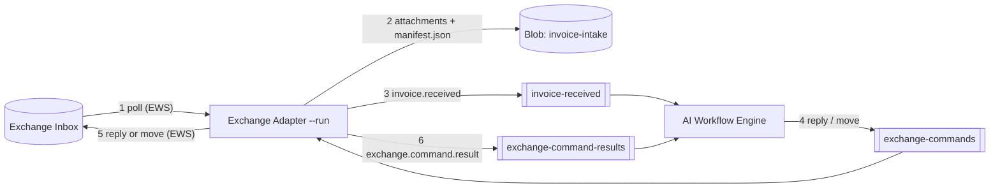

# Exchange Integration Service

A small .NET 10 Windows application that connects one mailbox on an **on-premises Exchange Server Subscription Edition
(SE)** to an AI Workflow Engine in Azure. It talks to Exchange Web Services (EWS) with **Windows Integrated
Authentication** and to Azure with Entra ID. One executable has two modes:

| Mode | Command | What it does |
|---|---|---|
| **Test** | `--probe` | Sends one read-only SOAP `GetFolder` for the Inbox. This proves the EWS endpoint is reachable over HTTPS, the process identity is accepted and that identity can open the configured mailbox. It prints a report and exits with a code per failure category. It needs no Azure. |
| **Service** | `--run` | Runs until stopped, normally as a Windows service. It copies each new Inbox email's attachments to **Azure Blob Storage**, announces the email on **Azure Service Bus**, and carries out the Engine's `reply` and `move` commands in Exchange. See [Service mode](#service-mode---run). |

The design is in [docs/exchange-adapter-engine-integration-design-short.html](docs/exchange-adapter-engine-integration-design-short.html).

> **Status: nothing has been verified live.** The automated tests use a mocked HTTP transport, a loopback socket server
> and in-memory fakes for Azure. Nothing in this repository has run against a real Exchange server or real Azure
> resources. Validate in this order:
> 1. A successful `--probe` under the intended identity against the customer's Exchange.
> 2. `--run` against an approved test mailbox and test Azure resources. See [Not yet verified](#not-yet-verified).

## What it does and does not do

| Does | Does not |
|---|---|
| Test mode: one read-only `GetFolder` for the Inbox of the configured mailbox | Test mode: read, change or store any mailbox content |
| Service mode: read Inbox emails and their file attachments, reply to the original sender, move an email to an allowed folder | Delete email, create folders, mark email as read, or reply to anyone except the original From address |
| Windows Integrated Authentication (Negotiate/NTLM) with the process identity for Exchange | Use Basic authentication, OAuth, Microsoft Graph, IMAP or SMTP |
| Entra ID (`DefaultAzureCredential`) for Azure | Use storage keys, SAS tokens or Service Bus connection strings |
| Validate configuration at startup and report every problem at once | Change Exchange settings or permissions, or create Azure resources |
| Run as a console app or as a Windows service | Install itself as a service (see [Run as a Windows service](#run-as-a-windows-service)) |

## Prerequisites

- **Windows host.** A domain-joined Windows 10/11 or Windows Server machine supported by .NET 10 (Windows Server 2016 or
  later recommended). Kerberos needs line of sight to a domain controller. The code compiles and the unit tests run on
  other operating systems, but the probe itself is meant for Windows.
- **.NET 10.** The .NET 10 SDK to build and run from source (`global.json` selects the newest installed 10.0.x SDK), or
  the .NET 10 runtime to run published output.
- **An Exchange Server SE EWS endpoint** reachable over HTTPS, normally `https://<exchange-host>/EWS/Exchange.asmx`,
  with a certificate the host trusts and whose names cover `<exchange-host>`.
- **An identity to authenticate as.** The dedicated Active Directory service identity that the service will eventually
  run as, or an approved development identity.
- **EWS enabled for that identity**: not switched off or blocked by an EWS access policy or throttling policy.
- **Mailbox permissions**:
  - Test mode: the identity must be allowed to see the target mailbox's Inbox.
  - Service mode: the identity also needs Full Access and Send As.

  See the [Exchange administrator checklist](#exchange-administrator-checklist).
- **Service mode only:**
  - An Azure Storage account and a Service Bus namespace with three queues.
  - Outbound network access from the host.
  - An Entra ID identity for the host.

  See [Azure setup](#azure-setup).

## Configuration

Settings come from `appsettings.json` and can be overridden without code changes. Later sources win:
`appsettings.json` -> `appsettings.<Environment>.json` -> environment variables -> command-line arguments.

```json
{
  "Exchange": {
    "EwsUrl": "https://mail.contoso.com/EWS/Exchange.asmx",
    "Mailbox": "ap-invoices@contoso.com",
    "AccessMode": "Delegated",
    "TimeoutSeconds": 30,
    "PollIntervalSeconds": 60,
    "MaxMessagesPerPoll": 20,
    "MoveFolders": [ "Processed" ]
  },
  "Azure": {
    "BlobServiceUri": "https://contosoinvoices.blob.core.windows.net",
    "IntakeContainer": "invoice-intake",
    "ServiceBusNamespace": "contoso-invoices.servicebus.windows.net",
    "InvoiceReceivedQueue": "invoice-received",
    "CommandsQueue": "exchange-commands",
    "CommandResultsQueue": "exchange-command-results",
    "UseWebSockets": false
  }
}
```

| Setting | Environment variable | Default | Rules |
|---|---|---|---|
| `Exchange:EwsUrl` | `Exchange__EwsUrl` | none, required | Absolute **HTTPS** URL, no embedded user name or password |
| `Exchange:Mailbox` | `Exchange__Mailbox` | none, required | Plain primary SMTP address, no display name |
| `Exchange:AccessMode` | `Exchange__AccessMode` | `Delegated` | Only `Delegated` is supported; `Impersonation` is reserved for a later milestone and is rejected |
| `Exchange:TimeoutSeconds` | `Exchange__TimeoutSeconds` | `30` | 1 to 300; covers each whole EWS request, including the authentication handshake |
| `Exchange:PollIntervalSeconds` | `Exchange__PollIntervalSeconds` | `60` | Service mode. 5 to 3600; the wait between Inbox polls |
| `Exchange:MaxMessagesPerPoll` | `Exchange__MaxMessagesPerPoll` | `20` | Service mode. 1 to 500; new emails captured per poll, oldest first. The rest wait for the next poll |
| `Exchange:MoveFolders` | `Exchange__MoveFolders__0`, `__1`, ... | `["Processed"]` | Service mode. The only folders a `move` command may name. These are display names of **top-level** folders (siblings of the Inbox) that already exist; paths are rejected |
| `Azure:BlobServiceUri` | `Azure__BlobServiceUri` | none, required in service mode | `https://<account>.blob.core.windows.net`, with no SAS token |
| `Azure:IntakeContainer` | `Azure__IntakeContainer` | `invoice-intake` | Existing container |
| `Azure:ServiceBusNamespace` | `Azure__ServiceBusNamespace` | none, required in service mode | Host name such as `<namespace>.servicebus.windows.net`, not a connection string |
| `Azure:InvoiceReceivedQueue` | `Azure__InvoiceReceivedQueue` | `invoice-received` | Existing queue, adapter → Engine |
| `Azure:CommandsQueue` | `Azure__CommandsQueue` | `exchange-commands` | Existing queue, Engine → adapter |
| `Azure:CommandResultsQueue` | `Azure__CommandResultsQueue` | `exchange-command-results` | Existing queue, adapter → Engine |
| `Azure:UseWebSockets` | `Azure__UseWebSockets` | `false` | `true` sends Service Bus traffic as AMQP over WebSockets on TCP 443 instead of AMQP on TCP 5671 |
| `Logging:LogLevel:Default` | `Logging__LogLevel__Default` | `Information` | Use `Debug` for more detail |

Test mode ignores the `Azure` section and the service-mode `Exchange` settings.

The values shipped in `appsettings.json` are **placeholders** (`contoso.com`, `contosoinvoices`). Replace them with
environment variables or a local override file. `appsettings.*.json` files other than `appsettings.json` are git-ignored,
so real host, mailbox and Azure resource names are not committed by accident.

All problems are reported at once, before anything is sent to Exchange or Azure, for example:

```text
Configuration errors (nothing was sent to Exchange):
  - Exchange:EwsUrl must use HTTPS (found 'http'); Windows authentication must not run over an unencrypted channel.
  - Exchange:Mailbox must be a plain SMTP address such as ap-invoices@contoso.com (no display name or surrounding spaces).
```

## Running locally

```powershell
dotnet build
dotnet test

$env:Exchange__EwsUrl  = "https://<your-exchange-host>/EWS/Exchange.asmx"
$env:Exchange__Mailbox = "<approved-mailbox>@<your-domain>"

dotnet run -- --probe
$LASTEXITCODE            # 0 only when the probe succeeded
```

The probe runs as the Windows identity of the process you start it from and prints it as `Windows Identity`. There is
deliberately no setting for an identity, user name or password. To probe as another account, such as the dedicated
service account, start the process as that account; see
[Run the probe under the intended identity](#run-the-probe-under-the-intended-identity).

A published build runs the same way: `dotnet publish -c Release -o <folder>`, then `<folder>\ExchangeIntegration.exe --probe`.

- `--probe` runs the one-time test and exits. `--run` starts service mode (see [Service mode](#service-mode---run)).
  `--help` prints usage. Running with neither or both prints usage and exits with 64.
- The report goes to **stdout**; structured logs go to **stderr**. Capture them separately with
  `dotnet run -- --probe 2> probe.log`.

> **Security note.** Windows Integrated Authentication answers any Negotiate or NTLM challenge with the credentials of
> the process. Point the probe only at the customer's own Exchange host, never at an arbitrary URL.

### Example output on success

```text
Exchange Integration - Connectivity Probe

Runtime:
  Windows Identity: CONTOSO\svc-invoiceews
  Access Mode: Delegated

Exchange:
  Endpoint: https://mail.contoso.com/EWS/Exchange.asmx
  Target Mailbox: ap-invoices@contoso.com

Results:
  HTTP Connection: SUCCESS
  Windows Authentication: SUCCESS
  Mailbox Access: SUCCESS
  EWS Operation: GetFolder
  EWS Response: NoError
  HTTP Status: 200
  Exchange Server Version: 15.2.2562.17
  Inbox Folder Id: returned (fingerprint 1A2B3C4D; the identifier is not printed)
  Negotiated Protocol: NOT VERIFIED (Kerberos versus NTLM cannot be told from this response; see README)

Overall: SUCCESS
```

This is an illustration, not an assumed result. A stage is reported as `SUCCESS` only when the evidence proves it:
reaching the endpoint is never taken as proof of authentication. The report also says `NOT CONFIRMED` (reached, but the
evidence does not decide) and `NOT EVALUATED` (never reached).

### Example output on failure

```text
Results:
  HTTP Connection: SUCCESS
  Windows Authentication: FAILED
  Mailbox Access: NOT EVALUATED
  EWS Operation: GetFolder
  EWS Response: (none)
  HTTP Status: 401

Failure:
  Category: Authentication
  Detail: HTTP 401: Exchange did not accept the Windows credentials of this process. The server offered: Negotiate, NTLM.
  Likely Area: Windows identity / Exchange authentication
  Next Step: Exchange did not accept the Windows credentials (HTTP 401). Confirm the identity shown above ...

Overall: FAILURE (exit code 5)
```

### Exit codes

| Code | Category | Meaning | Next step likely belongs to |
|---:|---|---|---|
| 0 | none | Authentication and Inbox access validated (`NoError`) | - |
| 1 | `Unexpected` | An error the probe did not anticipate | This application: rerun with `Logging__LogLevel__Default=Debug` |
| 2 | `Configuration` | Settings invalid; nothing was sent | Configuration |
| 3 | `Connectivity` | DNS, TCP or proxy failure; endpoint not reached | Network |
| 4 | `TlsFailure` | TLS or server certificate validation failed | Network and certificate trust |
| 5 | `Authentication` | HTTP 401: Windows credentials not accepted | Windows identity / Exchange authentication |
| 6 | `HttpAccessDenied` | HTTP 403: refused before mailbox permissions were evaluated | Exchange authentication / Exchange service |
| 7 | `MailboxAuthorization` | EWS answered but denied the mailbox (for example `ErrorAccessDenied`) | Mailbox permissions |
| 8 | `MailboxResolution` | EWS could not resolve the mailbox (for example `ErrorNonExistentMailbox`) | Mailbox / configuration |
| 9 | `SoapProtocol` | Response was not a valid EWS SOAP response | SOAP implementation / endpoint |
| 10 | `Timeout` | No complete response within `Exchange:TimeoutSeconds` | Network / Exchange service |
| 11 | `UnexpectedRedirect` | The endpoint redirected; redirects are never followed | Configuration / Exchange authentication |
| 12 | `UnexpectedHttpStatus` | A status that is not an EWS response (404, 5xx, 407, ...) | Exchange service / network |
| 13 | `EwsError` | EWS returned another error code (kept verbatim in the report) | Exchange service |
| 64 | - | Usage error: no command, or both `--probe` and `--run` | - |
| 130 | `Cancelled` | Cancelled with Ctrl+C | - |

These codes describe test mode. Service mode exits with 0 when stopped, 2 for invalid configuration and 1 for an
unexpected startup error. Exchange and Azure failures while it runs are logged and retried, and do not stop it.

### Run the probe under the intended identity

There is deliberately **no setting for an identity, user name or password**: nothing in `appsettings.json`, an
environment variable or a command-line argument selects one, and the probe never asks for credentials. It authenticates
as the **Windows identity of the process** and prints it as `Windows Identity`. To probe as another account, start the
process as that account.

**A successful run under a developer's personal identity does not establish that the eventual Windows service identity
will work**: mailbox permissions, EWS policies, Kerberos SPNs, network paths and the certificate trust of the host can
all differ. Repeat the probe as the real identity, on the real host, before relying on it.

1. **Development identity.** `dotnet run -- --probe` as the signed-in user. Useful for URL, certificate and mailbox
   configuration; says nothing about the service identity.
2. **A dedicated service account with a known password.** Publish once, then use `runas` to start a command prompt as
   that account and run the published executable from it:

   ```powershell
   # As yourself, once: publish to a folder that the service account can read and execute.
   dotnet publish -c Release -o C:\Apps\ExchangeIntegration

   # Start a command prompt as the service account. Type its password at the prompt.
   runas /user:CONTOSO\svc-invoiceews cmd
   ```

   In the new command prompt, which runs as that account:

   ```bat
   whoami
   cd /d C:\Apps\ExchangeIntegration
   ExchangeIntegration.exe --probe --Exchange:EwsUrl=https://<your-exchange-host>/EWS/Exchange.asmx --Exchange:Mailbox=<approved-mailbox>@<your-domain>
   echo %ERRORLEVEL%
   ```

   - **Confirm the identity.** `whoami` must print the account you intended (for example `contoso\svc-invoiceews`) and
     the probe's `Windows Identity:` line must name the same account (the case can differ). If either shows your own
     account, or they disagree, stop: the result does not describe the service account.
   - **Settings do not carry over.** `runas` starts the account's own environment, not that of the shell you ran it from
     (unless you pass `/env`), so `$env:Exchange__EwsUrl` and `$env:Exchange__Mailbox` set in your shell are **not**
     visible there. In the new prompt, set them again (`set Exchange__EwsUrl=...`), edit `appsettings.json` in the
     published folder, or pass `--Exchange:EwsUrl=...` and `--Exchange:Mailbox=...` as shown above.
   - **Access to the folder.** The account needs read and execute access to the published folder, so do not publish into
     your own profile folder.
   - **Do not use `runas /netonly`.** It changes the credentials used for network authentication but not the process
     identity, so the identity the probe prints would no longer be the identity Exchange sees. Avoid `/savecred` too: it
     stores the account's password where anything running as you can reuse it.
   - **If the account cannot log on to this machine** (for example it belongs to a domain with no trust, or policy denies
     it interactive logon, which is often done deliberately for service accounts), `runas` cannot start the prompt. Run
     the probe on a host that can log on the account, or have an administrator run it as that account by an approved
     method, such as a scheduled task that writes the output to a file. Never put the password in a script or on a
     command line.

## Service mode (`--run`)

Service mode runs two independent loops until it is stopped.



**Ingestion (Exchange → Azure)**, every `PollIntervalSeconds`:

1. **List the Inbox.** The adapter lists the Inbox oldest first: up to 50 pages of 200, plus each email's Message-ID.
   - Only emails (`IPM.Note*`) are considered.
   - An email without a Message-ID header is left alone and counted in a warning.
   - Emails are never changed or marked as read.
2. **Skip known emails.** Each email gets a `messageKey`: the first 32 hex characters of SHA-256 over the lower-cased
   mailbox, a newline and the Message-ID. An email whose `<messageKey>/manifest.json` is already marked announced is
   skipped.
3. **Capture.** Up to `MaxMessagesPerPoll` new emails are captured per poll:
   - Each file attachment goes to `<messageKey>/attachments/NN-<safe-name>`.
   - Attached emails (item attachments) are counted in the manifest but not stored.
   - Then `<messageKey>/manifest.json` is written.
4. **Announce.** One `invoice.received` message goes to Service Bus, with the Service Bus `MessageId` set to the
   `messageKey`.
5. **Checkpoint.** Only after the announcement does the adapter set the manifest's `announcedutc` blob metadata. That
   metadata is the only checkpoint: there is no database or local state.
   - After a crash, the email is captured and announced again.
   - Service Bus duplicate detection drops the repeat inside its window, and the Engine must treat `invoice.received` as
     idempotent anyway.
   - A failure on one email is logged and that email is retried on the next poll, without blocking the others.

**Commands (Azure → Exchange)** are processed one at a time from `exchange-commands`:

1. **Settle malformed messages.** A message that is not JSON, or has no well-formed `commandId`, is dead-lettered
   because no result could be correlated with it.
2. **Validate.** Every other command gets exactly one `exchange.command.result`. The checks are:
   - `type` is `exchange.command.reply` or `exchange.command.move`.
   - `mailbox` is the configured mailbox.
   - `messageKey` matches the mailbox and `internetMessageId`.
   - `commandId` is `<messageKey>.<suffix>`.
   - For a move, the folder is in `Exchange:MoveFolders`.
   - For a reply, the text is non-empty and at most 20,000 characters.
3. **Find the email.** The email is looked up in the Inbox by Message-ID. If it is not there, the result is `failed`
   ("already moved or deleted").
4. **Move.** The email moves to the named top-level folder. If several Inbox items share the Message-ID, only the
   first (oldest) is moved or replied to; the others stay in the Inbox and a warning is logged.
5. **Reply.** The reply is a **new** plain-text email sent as the mailbox. It goes **only to the original From
   address**; a `Reply-To` header is ignored because email content is untrusted. It has an `RE:` subject and
   `In-Reply-To`/`References` headers, and a copy is saved in Sent Items.
   - It is refused when the email came from the mailbox itself or carries an `Auto-Submitted` header other than `no`
     (loop guards).
6. **Record the outcome.** A command record at `<messageKey>/commands/<commandId>.json` makes repeats safe:
   - A command that already succeeded just republishes its stored result.
   - A reply is sent **at most once**. A `started` record is written before sending and stays if the outcome is unknown
     (for example a timeout), so a redelivered command reports `failed` with "check Sent Items" instead of sending again.
7. **Retry or fail.**
   - A transient EWS failure gives `failed` with `retryable: true`.
   - If Azure itself fails (the record or the result cannot be written), the message is abandoned. Service Bus then
     redelivers it up to the queue's max delivery count, then dead-letters it.

### Messages and blobs

All JSON is camelCase. Email content (sender, subject, file names) is **untrusted** input to the Engine.

```jsonc
// invoice-received queue: adapter → Engine
{
  "type": "invoice.received",
  "messageKey": "3f9a1c0e5b7d4a62c1e0f9b8a7d6c5e4",
  "mailbox": "ap-invoices@contoso.com",
  "internetMessageId": "<CAB123@vendor.example>",
  "receivedUtc": "2026-11-02T14:03:11+00:00",
  "manifest": "https://contosoinvoices.blob.core.windows.net/invoice-intake/3f9a1c0e5b7d4a62c1e0f9b8a7d6c5e4/manifest.json"
}

// <messageKey>/manifest.json in the intake container
{
  "messageKey": "3f9a1c0e5b7d4a62c1e0f9b8a7d6c5e4",
  "mailbox": "ap-invoices@contoso.com",
  "internetMessageId": "<CAB123@vendor.example>",
  "receivedUtc": "2026-11-02T14:03:11+00:00",
  "from": "billing@vendor.example",
  "subject": "Invoice 4711",
  "files": [
    { "name": "Invoice 4711.pdf", "blob": "3f9a1c0e5b7d4a62c1e0f9b8a7d6c5e4/attachments/01-Invoice_4711.pdf",
      "contentType": "application/pdf", "size": 48213, "isInline": false }
  ],
  "skippedAttachments": 0,
  "capturedUtc": "2026-11-02T14:03:40+00:00"
}

// exchange-commands queue: Engine → adapter (reply)
{
  "type": "exchange.command.reply",
  "commandId": "3f9a1c0e5b7d4a62c1e0f9b8a7d6c5e4.reply",
  "messageKey": "3f9a1c0e5b7d4a62c1e0f9b8a7d6c5e4",
  "internetMessageId": "<CAB123@vendor.example>",
  "mailbox": "ap-invoices@contoso.com",
  "reply": { "bodyText": "Please add the PO number and send the invoice again." }
}

// exchange-commands queue: Engine → adapter (move)
{
  "type": "exchange.command.move",
  "commandId": "3f9a1c0e5b7d4a62c1e0f9b8a7d6c5e4.move",
  "messageKey": "3f9a1c0e5b7d4a62c1e0f9b8a7d6c5e4",
  "internetMessageId": "<CAB123@vendor.example>",
  "mailbox": "ap-invoices@contoso.com",
  "move": { "folder": "Processed" }
}

// exchange-command-results queue: adapter → Engine (Service Bus CorrelationId = commandId)
{
  "type": "exchange.command.result",
  "commandId": "3f9a1c0e5b7d4a62c1e0f9b8a7d6c5e4.move",
  "messageKey": "3f9a1c0e5b7d4a62c1e0f9b8a7d6c5e4",
  "status": "failed",
  "reason": "The email is not in the Inbox (already moved or deleted).",
  "retryable": false,
  "completedUtc": "2026-11-02T14:05:02+00:00"
}
```

The `commandId` suffix is 1 to 64 characters of `A-Z a-z 0-9 _ -`. Reusing a `commandId` returns the first result
instead of acting again, so use a new suffix (for example `.reply2`) for a deliberate second reply. A typical flow:

- A valid invoice gets a `move`.
- An invalid invoice gets a `reply` and then, after its `succeeded` result, a `move`.

### Azure setup

Create these resources up front; the adapter never creates them.

| Resource | Settings | Adapter identity needs | Engine identity needs |
|---|---|---|---|
| Storage container `invoice-intake` | Private; consider soft delete and Defender for Storage malware scanning | Storage Blob Data Contributor (container scope) | Storage Blob Data Reader |
| Queue `invoice-received` | **Duplicate detection on** (it can only be set when the queue is created) | Azure Service Bus Data Sender | Azure Service Bus Data Receiver |
| Queue `exchange-commands` | Default lock duration and max delivery count are fine; the processor renews the lock | Azure Service Bus Data Receiver | Azure Service Bus Data Sender |
| Queue `exchange-command-results` | Defaults | Azure Service Bus Data Sender | Azure Service Bus Data Receiver |

Duplicate detection needs the Standard tier or higher. Messages are small, because they only point at blobs.

**Identity.** There are no keys or connection strings. The adapter uses `DefaultAzureCredential`, which tries these in
order:

- **Environment variables.** For example a certificate registered to an app in Entra ID: `AZURE_TENANT_ID`,
  `AZURE_CLIENT_ID` and `AZURE_CLIENT_CERTIFICATE_PATH`.
- **Managed identity.** On an on-premises host, this means connecting the host to **Azure Arc** and granting its managed
  identity the roles above. On Windows, the service account must be a member of the local
  **Hybrid agent extension applications** group (or Administrators) to obtain Arc tokens.
- **Developer sign-ins.** Visual Studio and Azure CLI work for local testing.

**Network.** The host only makes outbound connections. It needs:

- HTTPS (443) to the blob endpoint and to Entra ID.
- AMQP (5671) to Service Bus, or 443 with `Azure:UseWebSockets=true`.

### Run as a Windows service

```powershell
dotnet publish -c Release -o C:\Services\ExchangeIntegration

# Once, as an administrator: lets the service write warnings and errors to the Application event log.
New-EventLog -LogName Application -Source ExchangeIntegration

sc.exe create ExchangeIntegration binPath= "C:\Services\ExchangeIntegration\ExchangeIntegration.exe --run" start= delayed-auto
sc.exe failure ExchangeIntegration reset= 86400 actions= restart/60000/restart/60000/restart/300000
```

Then set the service's **Log On** account to the service identity in `services.msc`; the account needs the
"Log on as a service" right. Put the real settings in machine-level environment variables or in `appsettings.json` next
to the executable. Start the service.

- `Exchange` uses the service identity's Windows credentials.
- `Azure` uses `DefaultAzureCredential`.
- As a service, warnings and errors go to the Application event log (source `ExchangeIntegration`).
- To watch it work, stop the service and run `ExchangeIntegration.exe --run` in a console as the same identity. Logs
  then go to stderr.

Run **one** adapter per mailbox. Two instances would capture the same emails twice (harmless, because of duplicate
detection) and would split commands between them.

### Not yet verified

The service-mode EWS requests follow the EWS schema but have only been tested against recorded responses. Check these
against the customer's Exchange with a test mailbox before production:

- A new message accepts `InReplyTo` and `References`, so the reply threads in the sender's mail client.
- Setting `From` to the mailbox and sending with `SendAndSaveCopy` works with **Send As**, and the copy lands in the
  mailbox's Sent Items.
- `FindItem` with a restriction on `message:InternetMessageId` finds the email.
- `GetItem` returns `item:InternetMessageHeaders`, which the `Auto-Submitted` loop guard needs.
- `FindFolder` under `msgfolderroot` finds the `MoveFolders` by display name.
- `DefaultAzureCredential` obtains tokens through Azure Arc under the service account.

## Kerberos versus NTLM

`UseDefaultCredentials = true` asks Windows to authenticate with the process identity **using whichever of Negotiate
(Kerberos) or NTLM it can complete**. It does **not** guarantee Kerberos. A fallback to NTLM happens silently, for example
when the host name in `Exchange:EwsUrl` is an IP address or an alias with no matching SPN, when an SPN is missing or
duplicated, or when the client cannot reach a domain controller.

The probe therefore **never reports Kerberos as confirmed**, and a successful HTTP response is not evidence of it. The
report always prints `Negotiated Protocol: NOT VERIFIED`. To establish the protocol, use diagnostics the customer
approves, for example:

1. **Exchange server Security log (the authoritative evidence).** Event ID 4624 (successful logon, Logon Type 3) records
   the account, the *Logon Process* (`Kerberos` or `NtLmSsp`) and the *Authentication Package* (`Kerberos` or `NTLM`).
   Run the probe, then on the Exchange server (an administrator, with logon auditing enabled):

   ```powershell
   $xpath = "*[System[EventID=4624]] and *[EventData[Data[@Name='TargetUserName']='svc-invoiceews']]"
   Get-WinEvent -LogName Security -FilterXPath $xpath -MaxEvents 20 | ForEach-Object {
       $data = ([xml]$_.ToXml()).Event.EventData.Data
       [pscustomobject]@{
           Time         = $_.TimeCreated
           LogonType    = ($data | Where-Object Name -eq 'LogonType').'#text'
           LogonProcess = ($data | Where-Object Name -eq 'LogonProcessName').'#text'
           AuthPackage  = ($data | Where-Object Name -eq 'AuthenticationPackageName').'#text'
       }
   }
   ```

2. **Domain controller Security log.** Event ID 4769 (Kerberos service ticket requested) for the identity, with a service
   name matching the Exchange SPN, shows Kerberos was used. A missing 4769 is not proof of NTLM because the client may have
   used a cached ticket.
3. **IIS logs on the Exchange server** (`%SystemDrive%\inetpub\logs\LogFiles\W3SVC1`). Filter on the probe's User-Agent
   `ExchangeIntegration-EwsProbe/1.0` and read `cs-username`, `sc-status`, `sc-substatus`. On a new connection Kerberos
   typically shows one 401 challenge followed by 200, NTLM shows an extra 401 round trip. This is only an indication,
   because connection reuse changes the pattern.
4. **Client ticket cache.** `klist` in the identity's own session (for example the `runas` prompt described above) lists
   a `HTTP/<ews-host>` service ticket after a Kerberos-authenticated call (`klist purge` first for a clean test). The
   session of a Windows service cannot be inspected from an interactive session, so use the server-side evidence for it.
5. **SPN check.** `setspn -Q HTTP/<ews-host>` should return exactly one account; `setspn -X` finds duplicates. Kerberos
   works only for host names that have an SPN, so use the same name in `Exchange:EwsUrl`.

Record which protocol was observed, because a fallback to NTLM may be unacceptable for the customer's security policy.

## Exchange administrator checklist

The probe and this repository **never change Exchange settings or permissions**. Everything below is a read-only check
for the Exchange administrator, using the customer's change process for any fix. Replace the placeholder names.

1. **EWS endpoint.** Confirm the URL in the configuration is the real EWS URL and the certificate covers its host name.

   ```powershell
   Get-WebServicesVirtualDirectory -Server <exchange-server> | Format-List Identity, InternalUrl, ExternalUrl
   ```

2. **Windows authentication.** The probe only offers Windows credentials and never falls back to Basic, so Windows
   Integrated Authentication must be enabled on the EWS virtual directory (IIS providers `Negotiate` and `NTLM`).

   ```powershell
   Get-WebServicesVirtualDirectory -Server <exchange-server> | Format-List Identity, WindowsAuthentication, BasicAuthentication, OAuthAuthentication, WSSecurityAuthentication
   ```

3. **Delegated mailbox or folder permissions.** `GetFolder` on the Inbox succeeds only if the identity may see that folder.

   ```powershell
   Get-MailboxPermission -Identity ap-invoices@contoso.com -User 'CONTOSO\svc-invoiceews' | Format-List User, AccessRights, IsInherited, Deny
   Get-MailboxFolderPermission -Identity 'ap-invoices@contoso.com:\Inbox'
   ```

   Folder-level permissions can typically be granted only to mail-enabled principals (a mailbox, mail user or
   mail-enabled security group), whereas Full Access can be granted to any security principal such as a service account;
   agree the model with the customer.

   **Service mode needs more than the probe:**
   - **Full Access**, to read emails and attachments and to move emails.
   - **Send As**, because the reply is sent as the mailbox.
   - Every folder in `Exchange:MoveFolders` (by default `Processed`) must already exist as a top-level folder of the
     mailbox, next to the Inbox.

   ```powershell
   Get-ADPermission -Identity ap-invoices@contoso.com -User 'CONTOSO\svc-invoiceews' | Where-Object { $_.ExtendedRights -like '*Send-As*' }
   Get-MailboxFolderStatistics -Identity ap-invoices@contoso.com -FolderScope All | Where-Object { $_.FolderPath -eq '/Processed' }
   ```
4. **EWS access policies.** EWS can be switched off, or restricted to allow/block lists matched against the client
   **User-Agent**. Check the organization and both the service identity and the target mailbox.
   - The probe sends `User-Agent: ExchangeIntegration-EwsProbe/1.0`.
   - Service mode sends `ExchangeIntegration-Adapter/1.0`.

   Also review the throttling policy applied to the service identity.

   ```powershell
   Get-OrganizationConfig | Format-List EwsEnabled, EwsApplicationAccessPolicy, EwsAllowList, EwsBlockList
   Get-CASMailbox -Identity ap-invoices@contoso.com | Format-List EwsEnabled, EwsApplicationAccessPolicy, EwsAllowList, EwsBlockList
   ```

5. **Kerberos versus NTLM.** Confirm an SPN exists for the EWS host name (`setspn -Q HTTP/mail.contoso.com`), that no
   duplicates exist, and, for a load-balanced namespace, how Kerberos is configured:

   ```powershell
   Get-ClientAccessService -Identity <exchange-server> -IncludeAlternateServiceAccountCredentialStatus | Format-List Name, AlternateServiceAccountConfiguration
   ```

   Decide whether NTLM is acceptable as a fallback, or whether it must be disabled for this identity.
6. **Unattended service account eligibility.** The identity must be able to authenticate with no person present:
   - the account: enabled, password that does not expire unexpectedly, no smart card required, no logon-hour
     restriction, and not a member of the Protected Users group (it blocks NTLM);
   - the right to log on as a service (service mode) or as a batch job (a scheduled-task probe) on the host;
   - clocks within the Kerberos tolerance (5 minutes by default) of the domain, and HTTPS (TCP 443) reachable from the host.

## Troubleshooting

| What you see | Likely cause | What to check |
|---|---|---|
| `Connectivity`: *DNS name resolution failed* | Wrong host name or DNS not reachable from this host | `Resolve-DnsName <host>`; spelling of `Exchange:EwsUrl` |
| `Connectivity`: *connection could not be established* | Firewall, wrong port, proxy | `Test-NetConnection <host> -Port 443` |
| `TlsFailure`: *UntrustedRoot* / *PartialChain* | Host does not trust the CA that issued the Exchange certificate | Install the CA chain in the machine store. **Do not disable validation**; the application has no switch for it |
| `TlsFailure`: *RemoteCertificateNameMismatch* | URL host name is not in the certificate | Use a name the certificate covers |
| `Timeout` | Slow or blocked network path, Exchange/IIS under load, slow authentication | Network path, Exchange health, domain controller reachability; raise `Exchange:TimeoutSeconds` last |
| `Authentication` (401), server offered `Negotiate, NTLM` | Credentials rejected: disabled, locked or expired account, no trust to the Exchange domain, clock skew, Kerberos failing with NTLM blocked, Protected Users | Identity shown by the probe; server Security log (4625 failures); SPNs; time sync |
| `Authentication` (401), server offered only `Basic` | Windows authentication is not enabled on the EWS virtual directory | Administrator step 2. The probe never tries Basic |
| `HttpAccessDenied` (403) | EWS disabled or blocked by access policy or User-Agent list, IP restriction, WAF or proxy | Administrator step 4; IIS `sc-substatus` |
| `UnexpectedRedirect` (3xx) | URL points at OWA, ADFS, another host, or HTTP-to-HTTPS rewriting | Use the final EWS URL. Redirects are never followed so credentials are never forwarded |
| `UnexpectedHttpStatus` 404 | Wrong path | Use `/EWS/Exchange.asmx` |
| `UnexpectedHttpStatus` 407 | A proxy needs authentication | Bypass the proxy for the Exchange host or use an approved proxy configuration |
| `UnexpectedHttpStatus` 5xx | Exchange or IIS fault, or overload | Exchange and IIS logs |
| `SoapProtocol`: *not well-formed XML* / *not a SOAP envelope* | An HTML page (sign-in, proxy, WAF) answered, or the URL is not EWS | Open the URL in a browser; check proxies and load balancers. Rule these out before suspecting the SOAP implementation |
| `MailboxAuthorization`: `ErrorAccessDenied` (HTTP 200) | **Authenticated, but not permitted on this mailbox** | Administrator step 3. Permission changes can take a while to take effect |
| `MailboxResolution`: `ErrorNonExistentMailbox`, `ErrorInvalidSmtpAddress`, `ErrorNonPrimarySmtpAddress` | Not the primary SMTP address of an existing mailbox hosted on this Exchange | Check `Exchange:Mailbox`; ask the administrator whether the identity may see it |
| `EwsError`: `ErrorServerBusy` | Throttling or load (usually transient) | Retry later; throttling policy |
| `EwsError`: `ErrorInvalidServerVersion` | The server rejected the requested schema version | Report it; the request asks for `Exchange2013_SP1` |
| Works as me, fails as the service | Different permissions, policies, SPN or network | Run the probe as the intended identity (see above) |

**Distinguishing the two failures that matter most:** HTTP 401 (`Authentication`, exit 5) means Exchange did not accept
the Windows identity, so look at the identity and Exchange authentication. `ErrorAccessDenied` inside an HTTP 200
(`MailboxAuthorization`, exit 7) means Exchange authenticated the identity and then refused the mailbox, so look at
mailbox permissions. The report shows `Windows Authentication: SUCCESS` for the latter.

## Testing

```powershell
dotnet test
```

The tests need no Exchange server. They use a mocked HTTP transport and cover: a successful `GetFolder`; HTTP 401 and
403; SOAP-level access denial; mailbox resolution errors; other EWS error codes and SOAP faults; invalid SOAP; timeouts
and cancellation; TLS and DNS failures; invalid configuration and environment/argument overrides; and redirect handling.
A loopback socket server exercises the **real** `HttpClientHandler` to prove that redirects are not followed and that a
`Basic` or `Digest` challenge is never answered, so there is no insecure authentication fallback. Other tests assert that
logs and reports never contain bodies, tokens or the full folder identifier.

Service mode is tested without Exchange or Azure:

- **EWS requests.** `EwsMailbox` is checked against recorded EWS responses for paging, attachment decoding, the reply's
  element order, folder lookup and error classification.
- **Ingestion and commands.** These run against in-memory fakes of the mailbox, Blob Storage and Service Bus. The tests
  cover:
  - capture order and the restart checkpoint;
  - retry after a failed announcement;
  - the per-poll cap;
  - every command validation rule;
  - idempotent repeats;
  - the at-most-once reply;
  - the loop guards;
  - dead-lettering.

The JSON contracts and the dependency injection wiring for both modes are covered too.

### Optional live integration tests (customer-approved test mailbox)

Skipped unless explicitly enabled. They perform the same read-only Inbox `GetFolder` as the probe. Run them as the intended
Windows identity, against a mailbox the customer has approved for testing:

```powershell
$env:EXCHANGE_LIVE_TESTS = "1"
$env:Exchange__EwsUrl    = "https://<your-exchange-host>/EWS/Exchange.asmx"
$env:Exchange__Mailbox   = "<customer-approved test mailbox>"
dotnet test --filter "FullyQualifiedName~LiveExchangeTests"
```

### Validating a deliberately unauthorized mailbox (negative test)

This proves the identity is **not** over-privileged. Run it **only against a mailbox that the mailbox owner and the
security team have approved for security testing**; failed access attempts can raise audit alerts. Never guess mailbox names.

1. Obtain written approval and have the Exchange administrator confirm the service identity has **no** permission on that
   mailbox (`Get-MailboxPermission` and `Get-MailboxFolderPermission` show no grant).
2. Run the probe against it:

   ```powershell
   $env:Exchange__Mailbox = "<mailbox-approved-for-security-testing>"
   dotnet run -- --probe
   ```

3. **Expected:** `Windows Authentication: SUCCESS`, `Mailbox Access: FAILED`, `EWS Response: ErrorAccessDenied`,
   `Category: MailboxAuthorization`, exit code 7.
4. If the result is `Overall: SUCCESS`, the identity can reach a mailbox it should not: report it to the Exchange
   administrator. If it is `MailboxResolution`, the address does not resolve; choose an existing mailbox.

The same check exists as a live test: set `EXCHANGE_LIVE_TESTS=1` and
`EXCHANGE_LIVE_TESTS_UNAUTHORIZED_MAILBOX=<mailbox-approved-for-security-testing>`.

## Design notes

- **Authentication:** `ExchangeHttpClientFactory` builds `new HttpClientHandler { UseDefaultCredentials = true, AllowAutoRedirect = false }`.
  No user names or passwords exist anywhere, nothing prompts for a login, and nothing falls back to another credential mechanism.
- **TLS:** certificate validation is never bypassed (no validation callback), and HTTPS is required twice: by configuration
  validation and again by the EWS client before it sends anything.
- **Redirects:** never followed; they are reported as `UnexpectedRedirect` with scheme, host and path only.
- **Read-only request:** the only operation is `GetFolder` for the `inbox` `DistinguishedFolderId` with a `Mailbox` child,
  asking for `IdOnly` plus `DisplayName`. A success needs HTTP 200, `ResponseClass="Success"` **and** `ResponseCode`
  `NoError`; an HTTP 200 alone is never success.
- **Diagnostics without leakage:** logs are structured and never contain request or response bodies, authentication
  headers, tokens or message content. Server-supplied text is sanitized (control characters removed, token-like runs
  masked, length capped). The Inbox identifier is shown only as a short fingerprint. For a 401 only the *names* of the
  offered authentication schemes are reported.
- **Impersonation later:** `ExchangeAccessMode` reserves `Impersonation` (currently rejected), `EwsRequestBuilder` is the
  single place SOAP headers are produced (where `ExchangeImpersonation` will go), and `IEwsClient` takes the mailbox per
  call so scope can be decided per mailbox.
- **Two modes, one composition root:** `Program.cs` requires exactly one of `--probe` or `--run`.
  - `AddExchangeIntegration` registers the probe.
  - `AddExchangeAdapter` adds the Azure clients, `AddWindowsService()` and the two `BackgroundService` workers,
    `IngestionWorker` and `CommandWorker`.
  - Configuration is resolved relative to the application directory, which a service needs because its working
    directory is `System32`.
- **Service mode stays small on purpose:**
  - There is no database and no local state; the blob manifest and command records are the checkpoints.
  - Commands run one at a time.
  - The Inbox is re-listed on every poll, so the Engine must keep it short by moving handled emails.
  - Service mode uses its own `HttpClient`, with the same Windows authentication, no redirects and TLS rules, and a 128 MB
    response limit for attachments.
- **Untrusted email:** nothing in an email chooses a recipient, folder or command. The reply recipient is the From
  address, folders come from configuration, and logs contain only message keys, never addresses, subjects or file names.

## Project layout

```text
ExchangeIntegration.slnx
global.json
ExchangeIntegration.csproj
Program.cs                      Host composition root: --probe (test mode) and --run (service mode)
appsettings.json                Placeholder settings
Configuration/                  ExchangeOptions, AzureOptions, startup validation, service registration
Authentication/                 ExchangeHttpClientFactory (Windows authentication), process identity
Exchange/                       IEwsClient/EwsClient (probe), IExchangeMailbox/EwsMailbox (service), SOAP builder and parser, failure categories, redaction
Diagnostics/                    ExchangeConnectivityProbe, ConnectivityResult, console report
Adapter/                        Service mode: JSON contracts, message keys, ingestion, command handling, the two workers
Cloud/                          Blob Storage and Service Bus implementations of the adapter's ports
docs/                           Design document
ExchangeIntegration.Tests/      xUnit tests (mocked HTTP transport, loopback server, in-memory fakes, opt-in live tests)
```

## Explicitly out of scope for this version

Microsoft Graph; IMAP or SMTP; OAuth for Exchange; EWS impersonation; a database; nested move folders or creating
folders; reply templates, HTML replies or attachments on replies; a standby adapter; installer or deployment automation;
metrics and alerting beyond logs; Exchange administration changes.

Deferred for now: running under a group Managed Service Account (gMSA). It is not documented or tested yet. The
application does not select or restrict the identity (it uses the identity of the process), so this is a scope decision
for the documentation, not a limitation enforced by the code.

## Recommended next step

1. Run the probe under the intended identity on the intended host against the customer's Exchange, record the observed
   protocol (Kerberos or NTLM), and run the negative test with an approved mailbox. Only then mark live connectivity verified.
2. Grant Full Access and Send As on an approved **test** mailbox, create test Azure resources (see
   [Azure setup](#azure-setup)), and run `--run` in a console as the service identity.
3. Work through the [Not yet verified](#not-yet-verified) list by hand: send test invoices to the mailbox and put
   `reply` and `move` commands on `exchange-commands`. Then build the Engine side against the
   [messages](#messages-and-blobs).
